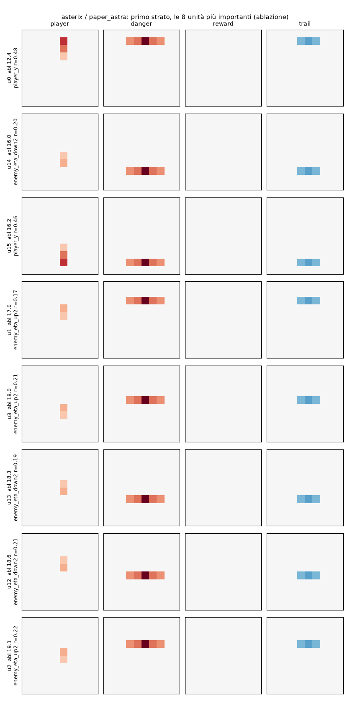
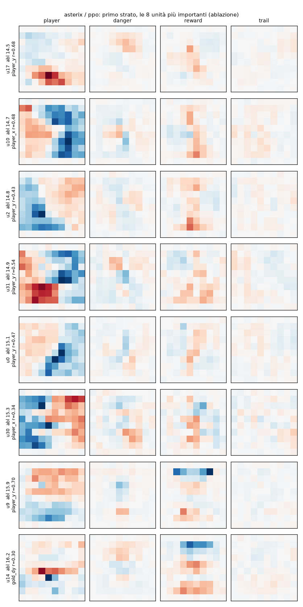

# PPO on Asterix: what weights does it find, and can they be read?

`train.py` trains with PPO a 600-32-32-6 tanh network, the same architecture as the network that GPT-6 Astra wrote
by hand in the article (`paper_astra.json`), and saves it in `weights/asterix/ppo.json`. `analyze.py` takes the same
measurements on the two networks. Astra's network is decoded neuron by neuron in
[`decode_astra`](../decode_astra/README.md) and serves as the reference. The measurements are those of
[PPO on Low Tide](../../low_tide/ppo/README.md) and [PPO on Breakout](../../breakout/ppo/README.md), explained there.

**In brief.**

- **How it plays:** 24.6 points, less than half of Astra's 54.8 (always playing the most likely move, 46 against
  65). The curve is still rising after 200M steps.
- **It plays in a different way:** Astra stays still in column 5 and chooses the row; PPO moves between columns 3
  and 6 and uses all the moves, each about one fifth of the time.
- **What the weights are like:** dense and distributed.
  - It uses all 315 live inputs, with 10,029 distinct values; Astra uses 4.6% of them, with 33 values.
  - Keeping a quarter of the live weights of the first layer, it loses three quarters of the score; Astra holds up
    with 5%.
  - No neuron computes "is there an incoming enemy in the row above / below / mine", the alarms Astra relies on:
    |r| 0.08-0.14 against 0.64-0.67.
  - A depth-6 tree imitates it in only 49% of the states (Astra: 92%).
- **What can be read:** half of the first-layer weight is on the **player's position**, with smooth maps; some on
  the treasures near the central columns; almost nothing on the enemies and their direction. The network knows well
  where it is, and little about what is coming.

```bash
uv run --group ppo python experiments/asterix/ppo/train.py          # ~1h50 on one core (200M steps)
uv run --group analysis python experiments/asterix/ppo/analyze.py   # ~10 min with 4 processes
```

## 1. Training

As for Breakout (`src/small_games/ppo.py`, PPO with clipping and GAE): actor 600-32-32-6 tanh, critic 600-64-64-1,
64 environments, rollouts of 128 steps, Adam lr 5·10⁻⁴ decaying to 0, sticky actions 0.1 as in the evaluation,
training seeds far from those of the evaluation. MinAtar's minimal action set for Asterix: all actions except fire,
which does nothing here. **Entropy coefficient 0.05**, 200 million steps.

The first attempt (`ppo_v1`: 6 actions, entropy 0.01, 30M steps) scored 9.1 points and was still rising. The three
runs of `experiments/ppo_runs.py` differ only in the entropy coefficient:

| run | passes 12 points | training return at 50M / 100M / 200M | evaluation (1000 episodes) |
|---|---|---|---|
| `ppo_ent01` (0.01) | at 68M steps | 8.6 / 14 / 20 | 19.4 ± 0.4 |
| **`ppo_ent05` (0.05)** | **at 52M steps** | 11 / 17 / 25 | **24.6 ± 0.5** |
| `ppo_ent10` (0.1) | at 65M steps | 8.8 / 12 / 16 | 15.5 ± 0.4 |
| Astra's network | | | 54.8 ± 1.1 |

`weights/asterix/ppo.json` is `ppo_ent05`. Here there is no plateau to escape from, but a slow and steady climb:
with more steps the network would improve further.

## 2. How it plays

| | `paper_astra` | `ppo_v1` | `ppo` |
|---|---|---|---|
| score (200 episodes, sampled) | 54.5 ± 2.5 | 9.0 ± 0.5 | 26.8 ± 1.2 |
| greedy score | 65.1 | 10.2 | 45.8 |

On the states played by the two networks (20 episodes, most likely moves):

| | `paper_astra` | `ppo` |
|---|---|---|
| player column | always 5 | 3: 13%, 4: 30%, 5: 32%, 6: 16%, others 9% |
| moves: no-op, left, up, right, down | 79, 0, 11, 0, 10% | 20, 18, 21, 18, 22% |

Astra turns Asterix into a one-dimensional game: all the enemies and treasures pass through column 5, so it is
enough to stay there and choose the row. PPO stays near the middle but has not found this simplification.

## 3. What PPO weights look like

| | `paper_astra` | `ppo_v1` | `ppo` |
|---|---|---|---|
| nonzero weights | 2.8% | 100.0% | 99.8% |
| distinct values in the first layer | 33 | 18,609 | 18,757 |
| inputs that make up 90% of a neuron's weight (median, out of 600) | 10 | 345 | 282 |
| largest weight in absolute value | 80.00 | 1.75 | 3.95 |

(The 0.2% of zeros of `ppo` is the output row of fire, which is excluded.)

285 inputs out of 600 are always zero: the projectile and gauge channels, row 0 and row 9 of the others, and some
cells of the player. The PPO weights on these stay those of the random initialization (see Breakout). Restricted to
the live inputs:

| first layer, only the 315 live inputs out of 600 | `paper_astra` | `ppo_v1` | `ppo` |
|---|---|---|---|
| nonzero weights | 4.6% | 100.0% | 100.0% |
| distinct values | 33 | 9,961 | 10,029 |
| inputs that make up 90% of a neuron's weight (median, out of 315) | 10 | 183 | 167 |
| mean \|w\| on the dead / live inputs | 0.000 / 0.374 | 0.050 / 0.132 | 0.054 / 0.293 |

How much each channel weighs in the first layer (share of the sum of |w| over the live inputs):

| | player | enemies (danger) | treasures (reward) | trail |
|---|---|---|---|---|
| `paper_astra` | 6% | 23% | 34% | 37% |
| `ppo` | 49% | 14% | 28% | 9% |

Astra uses the trail a lot, because that is where it tells whether an enemy is coming or moving away (section 4.1
of `decode_astra`). PPO puts half of its weight on its own position.

**Astra's network:** each neuron looks at one row: "is there an incoming enemy in row k, above / below / in mine?",
"is there an incoming treasure in row k?".



**PPO network:**



In the player channel there are smooth, wide maps: u17 is positive at the bottom center, u10 negative on the right,
u31 positive at the bottom left and negative at the top right. They are an encoding of the position by zones. In the
reward channel several neurons have a vertical stripe over columns 4-5, that is "a treasure near the middle". The
danger and trail channels are almost flat.

## 4. How many weights are needed (pruning)

All layers (200 episodes):

| weights kept | 100% | 50% | 25% | 10% | 5% | 2% |
|---|---|---|---|---|---|---|
| `paper_astra` | 54.5 | 54.5 | 54.5 | 54.5 | 30.2 | 0.5 |
| `ppo_v1` | 9.0 | 9.1 | 5.6 | 1.6 | 0.7 | 0.6 |
| `ppo` | 26.8 | 17.4 | 0.6 | 0.4 | 0.5 | 0.5 |

First layer only, on the live inputs:

| live first-layer weights kept | 100% | 50% | 25% | 10% | 5% |
|---|---|---|---|---|---|
| `paper_astra` | 54.5 | 54.5 | 54.5 | 54.5 | 54.5 |
| `ppo_v1` | 9.0 | 8.7 | 6.0 | 1.8 | 1.2 |
| `ppo` | 26.8 | 19.6 | 7.3 | 1.6 | 0.9 |

## 5. How much each neuron counts (ablation)

| | neurons (constant) | that cost more than 10% | more than 50% | maximum loss | reference |
|---|---|---|---|---|---|
| `paper_astra` | 64 (0) | 41 | 14 | 50.7 | 55.0 ± 3.5 |
| `ppo_v1` | 64 (0) | 8 | 0 | 1.7 | 9.0 ± 0.7 |
| `ppo` | 64 (0) | 62 | 2 | 15.7 | 26.7 ± 1.7 |

- **Astra:** 14 neurons on their own remove more than half of the score. The two worst are the second-layer alarms
  for "up" and "down" (|r| 0.82 with the arrival of an enemy two rows above or below).
- **PPO:** almost all neurons count a little (62 out of 64 more than 10%), almost none a lot. The most important
  ones are correlated with the player's position (|r| up to 0.68 with row or column).

## 6. What the neurons compute

### The quantities of Astra's algorithm

| quantity | `paper_astra` r / R² | `ppo_v1` r / R² | `ppo` r / R² |
|---|---|---|---|
| incoming enemy in my row (≤ 3) | **0.67** / 0.45 | 0.10 / 0.04 | 0.08 / 0.06 |
| incoming enemy in the row below (≤ 2) | **0.64** / 0.43 | 0.11 / 0.05 | 0.14 / 0.16 |
| incoming enemy in the row above (≤ 2) | **0.65** / 0.48 | 0.12 / 0.06 | 0.13 / 0.11 |
| incoming treasure in my row | 0.30 / **1.00** | 0.15 / 0.08 | 0.10 / 0.16 |

Even in Astra r does not reach 1, because each alarm is split across eight neurons, one per row (section 4 of
`decode_astra`); but the layer contains them in a readable form. In PPO these quantities are not there, not even as
a linear combination: this is consistent with the almost flat weights on the enemy channels.

### Boolean or graded neurons

| | `paper_astra` layer 0 | `paper_astra` layer 1 | `ppo` layer 0 | `ppo` layer 1 |
|---|---|---|---|---|
| saturated tanh neurons (\|a\| > 0.95) | 95% | 90% | 12% | 58% |
| neurons with \|r\| ≥ 0.8 with a game quantity | 0/32 | 2/32 | 0/32 | 0/32 |
| mean R² of a neuron on the game quantities | 0.15 | 0.19 | 0.28 | 0.37 |

In Astra 39 neurons out of 64 are switches (saturated in more than 90% of the states, sometimes on one side and
sometimes on the other); in PPO none are. As in Seaquest, the quantities of the vocabulary explain the PPO neurons
better than those of Astra: almost all PPO neurons follow the player's position, which is in the vocabulary, while
Astra computes conditions on single rows.

## 7. Can it be written as a rule? (distillation)

| depth | `paper_astra` agreement / leaves / points | `ppo_v1` | `ppo` |
|---|---|---|---|
| 1 | 78.7% / 2 | 34.2% / 2 | 31.0% / 2 |
| 2 | 82.6% / 4 / 2.2 | 40.3% / 4 / 0.7 | 37.2% / 4 / 1.3 |
| 4 | 88.4% / 16 / 3.3 | 49.9% / 16 / 2.8 | 43.8% / 16 / 2.3 |
| 6 | 92.1% / 40 | 52.3% / 48 | 49.0% / 54 |
| 8 | 93.8% / 68 / 36.3 | 56.7% / 98 / 3.2 | 50.9% / 127 / 4.7 |
| 12 | 95.9% / 112 / 42.5 | 57.7% / 182 / 3.5 | 53.8% / 337 / 6.7 |
| the network, greedy | 65.1 | 10.2 | 45.8 |

Astra becomes a tree of 68 leaves that plays at 36 points. For PPO no tree goes beyond 54% agreement, and none of
them plays: its policy is the least compressible of the three MinAtar games. The depth-2 tree says "go back toward
the middle, and go up if the nearest treasure is above", and gets one move in three right.

## 8. Conclusion

- **Astra:** the weights are the program. Alarms per row, attraction toward the treasures, round weights on few
  inputs, a one-dimensional strategy.
- **PPO:** it plays at half of Astra's level, and its weights do not have this form:
  - it uses all the live inputs, with continuous values, and does not withstand pruning;
  - the computation is distributed over all the neurons, none of which is an alarm or a condition;
  - half of the weight is on its own position, almost nothing on the direction of the enemies;
  - the behavior does not compress into a tree.

Over the course of training and with the other entropies the picture is the same: see
[`experiments/ppo_over_training`](../../ppo_over_training/README.md).

## Files

- `train.py`: configuration and launch of the training (the one of `ppo.json`).
- `analyze.py`: all the measurements; with `--only-key` only the key quantities and the measurements on the live
  inputs.
- `results/ppo_ent01/`, `results/ppo_ent05/`, `results/ppo_ent10/`: the three runs of 200M steps (curve
  `train_log.csv`, `checkpoint_*M.json` every 5M steps, `eval.json`, `final.pt`, `console.log`).
- `results/ppo_v1/`: the first attempt (6 actions, entropy 0.01, 30M steps).
- `results/analysis/`: `analysis.json` (all the numbers), `trees_*.txt` (trees of depth 1-4), `fields_*.png`
  (images of the first layer).
