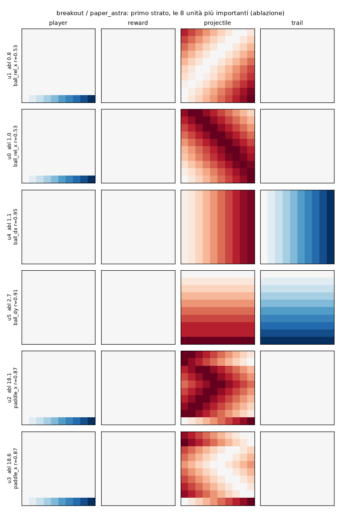
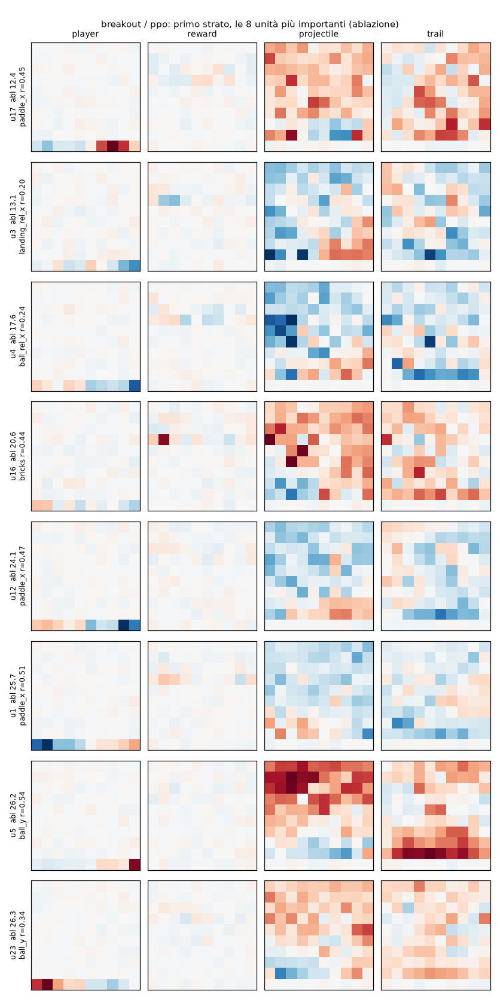

# PPO on Breakout: what weights does it find, and can they be read?

`train.py` trains with PPO a 600-32-32-6 tanh network, the same architecture as the network that GPT-6 Astra wrote
by hand in the article (`paper_astra.json`). It saves it to `weights/breakout/ppo.json`, in the same format.
`analyze.py` takes the same measurements on the two networks. Astra's network is already decoded neuron by neuron
([`decode_astra`](../decode_astra/README.md)), so it serves as a reference point: it shows what weights that *are*
an algorithm look like under these measurements. The measurements are those of
[PPO on Low Tide](../../low_tide/ppo/README.md), explained there in detail.

**In short.**

- **How it plays:** PPO reaches 63 points, against Astra's 512. It gets out of the ~6-point plateau of the first
  attempts only with more entropy (section 1), but it stays far from Astra.
- **What the weights are like:** dense and distributed, as on Low Tide.
  - It uses all 220 live inputs (those that are not always zero), with 7,027 distinct values; Astra uses 10% of
    them, with 53 values.
  - It does not tolerate pruning: keeping half of the live weights of the first layer, it no longer plays. Astra
    holds up with a tenth.
  - No neuron computes the quantities of Astra's algorithm ("where the ball would land if it went down to the
    right"): |r| 0.31-0.34 against 0.94.
  - A depth-6 tree imitates it in 72% of the states (Astra: 89%).
- **What can be read:** the most important neurons of the first layer read the **paddle position** with a
  per-column profile, and the ball with broad blobs, with no recognizable shape. Unlike Low Tide, however, many
  neurons matter: 10 neurons out of 64, each on its own, remove more than half of the score.

```bash
uv run --group ppo python experiments/breakout/ppo/train.py          # ~1h50 on one core (200M steps)
uv run --group analysis python experiments/breakout/ppo/analyze.py   # ~10 min with 4 processes
```

## 1. Training

The algorithm is in `src/small_games/ppo.py`: standard PPO with clipping and GAE, like CleanRL's `ppo.py`.

| | |
|---|---|
| network (actor) | 600-32-32-6, tanh; exported as is |
| actions | MinAtar's minimal action set: no-op, left, right. The other three (up, down, fire) do nothing and have logit −100 |
| critic | 600-64-64-1, tanh; not exported |
| environments | 64 in parallel, rollouts of 128 steps (8192 steps per update) |
| optimization | 4 epochs, 8 minibatches, Adam lr 5·10⁻⁴ decaying to 0, clip 0.2 |
| exploration | **entropy coefficient 0.05** |
| duration | 200 million steps, ~1h50 |
| environment | the evaluation one: sticky actions 0.1, 10,000 steps; seeds from 1,000,000 up, never the evaluation ones |

### The plateau

The first attempts stopped at ~6 points:

- **`ppo_v1`** (all 6 actions, entropy 0.01, 30M steps): 5.8 points. Four actions out of six do not move the
  paddle, and the policy ends up almost never moving.
- **A larger network** (256-256, outside the rules, `control_big.py`): 6.8 after 6M steps. Size is not the issue.
- **"Follow the ball"** (`follow_ball.py`, the paddle moves toward the ball's column): 8.4. It would be enough to
  beat the plateau, but it does not go far.

With the minimal action set (3 actions) and more entropy, PPO gets out of the plateau. The three runs of
`experiments/ppo_runs.py`, 200M steps each, differ only in the entropy coefficient:

| run | passes 10 points | training return at 50M / 100M / 200M | evaluation (1000 episodes) |
|---|---|---|---|
| `ppo_ent01` (0.01) | at 15M steps | 27 / 31 / 35 | 34.7 ± 0.5 |
| **`ppo_ent05` (0.05)** | **at 3.5M steps** | 37 / 60 / 64 | **63.2 ± 1.0** |
| `ppo_ent10` (0.1) | at 2.2M steps | 26 / 33 / 54 | 52.2 ± 1.4 |
| Astra's network | | | 512.5 ± 7.6 |

`weights/breakout/ppo.json` is `ppo_ent05`. After 100M steps its curve oscillates between 55 and 68 without rising
further. Astra scores 512 by predicting the column where the ball will land after the bounces; PPO, with this
network and these steps, does not get there.

## 2. The score

| | `paper_astra` | `ppo_v1` | `ppo` |
|---|---|---|---|
| score (200 episodes, sampled) | 512.7 ± 16.9 | 5.8 ± 0.1 | 62.4 ± 2.5 |
| greedy score | 512.7 | 5.7 | 69.4 |

## 3. What PPO weights look like

Over all 600 inputs:

| | `paper_astra` | `ppo_v1` | `ppo` |
|---|---|---|---|
| nonzero weights | 3.9% | 100.0% | 99.5% |
| distinct values in the first layer | 55 | 18,500 | 18,732 |
| first-layer neurons with all weights at zero | 26 | 0 | 0 |
| inputs that make up 90% of a neuron's weight (median, out of 600) | 84 | 359 | 270 |
| largest weight in absolute value | 1000.00 | 1.47 | 3.29 |

(The 0.5% of zeros in `ppo` are the output rows of the three excluded actions.)

**The live inputs.** In Breakout 380 inputs out of 600 are always zero: the danger and gauge channels, the paddle
outside row 9, the ball and its trail in row 9, the bricks outside rows 1-3. PPO receives no gradient on their
weights, which stay those of the random initialization (verified: identical between the 5M-step checkpoint and the
end). They are small, but nonzero and all different, and they inflate the numbers above without saying anything
about what the network learned. Restricted to the live inputs (those nonzero in at least one state played by one of
the three networks):

| first layer, only the 220 live inputs out of 600 | `paper_astra` | `ppo_v1` | `ppo` |
|---|---|---|---|
| nonzero weights | 9.9% | 100.0% | 100.0% |
| distinct values | 53 | 6,983 | 7,027 |
| inputs that make up 90% of a neuron's weight (median, out of 220) | 77 | 127 | 136 |
| mean \|w\| on dead / live inputs | 0.296 / 3.315 | 0.046 / 0.116 | 0.046 / 0.406 |

The picture does not change: the PPO network uses every live input, with values that are all different.

The images show the first-layer weights of the most important neurons (those whose ablation loses the most points,
section 5): one row per neuron, one panel per channel (red positive, blue negative).

**Astra's network:** six neurons, and you can read what they do. Two encode the ball's direction (horizontal and
vertical gradients between the ball and its trail), four are "ball cell → landing column" tables, compared with the
paddle position (the gradient in row 9 of the player channel).



**PPO network:**



- **Paddle:** in the player channel the only live weights are those of row 9, the only row where the paddle can be,
  and they change with the column: some neurons respond to the paddle on the right (u17, u5), others on the left
  (u1, u23). This is the most readable part of the network.
- **Ball:** in the projectile and trail channels there are broad blobs, with some preferences (u5 increases when the
  ball is in the upper rows), but without Astra's table structure.

## 4. How many weights are needed (pruning)

Keeping the same fraction of the largest weights in every layer (200 episodes):

| weights kept | 100% | 50% | 25% | 10% | 5% | 2% |
|---|---|---|---|---|---|---|
| `paper_astra` | 512.7 | 512.7 | 512.7 | 512.7 | 512.7 | 0.5 |
| `ppo_v1` | 5.8 | 5.8 | 3.6 | 2.0 | 1.9 | 0.7 |
| `ppo` | 62.4 | 40.1 | 2.9 | 0.7 | 0.3 | 0.3 |

Only the first layer, on the live inputs (the weights of the dead inputs set to zero, then the stated fraction of
the largest live weights is kept; the other layers stay whole):

| live first-layer weights kept | 100% | 50% | 25% | 10% | 5% |
|---|---|---|---|---|---|
| `paper_astra` | 512.7 | 512.7 | 512.7 | 512.7 | 0.5 |
| `ppo_v1` | 5.8 | 4.1 | 3.0 | 2.1 | 2.4 |
| `ppo` | 62.4 | 0.6 | 0.4 | 0.5 | 0.6 |

Astra's network loses only zeros down to 10%. The PPO network does not hold up even with half of the live
first-layer weights: it needs almost all of them.

## 5. How much each neuron matters (ablation)

A neuron is replaced, at every step, with the value it had in another state taken at random, and we measure how
many points are lost (100 episodes per neuron).

| | neurons (constant) | that lose more than 10% | more than 50% | maximum loss | reference |
|---|---|---|---|---|---|
| `paper_astra` | 64 (50) | 14 | 14 | 517.7 | 518.5 ± 23.2 |
| `ppo_v1` | 64 (0) | 0 | 0 | 0.2 | 5.8 ± 0.1 |
| `ppo` | 64 (0) | 36 | 10 | 49.4 | 61.8 ± 3.2 |

- **Astra:** it uses 14 neurons out of 64 (the other 50 have zero weights) and each one is indispensable.
- **PPO:** it uses all 64 neurons. More than half matter, and 10, each on its own, remove more than half of the
  score. This differs from PPO on Low Tide, where no neuron mattered: in a network with 32 units per layer every
  neuron carries part of the computation, and removing one breaks it. Mattering, however, does not mean having a
  meaning: the most important one (u17 of the first layer, a loss of 49 points out of 62) has |r| 0.45 with the
  paddle position, and no game variable explains it better.

## 6. What the neurons compute

### The quantities of Astra's algorithm

For each quantity: the highest correlation with a single neuron (|r|) and how well a linear combination of all the
neurons of the layer reconstructs it (R², on episodes not used for the combination). The best layer:

| quantity | `paper_astra` r / R² | `ppo_v1` r / R² | `ppo` r / R² |
|---|---|---|---|
| landing column − paddle | 0.42 / 0.18 | 0.17 / 0.22 | 0.24 / 0.26 |
| landing if it went down to the right − paddle | **0.94 / 0.92** | 0.30 / 0.35 | 0.31 / 0.48 |
| landing if it went down to the left − paddle | **0.94 / 0.92** | 0.51 / 0.47 | 0.34 / 0.51 |
| ball − paddle (columns) | 0.53 / 0.48 | 0.33 / 0.63 | 0.27 / 0.43 |
| the ball is going down | **0.84** / 0.72 | 0.30 / 0.26 | 0.56 / 0.44 |

Astra computes "where it would land if it went down to the right/left" in one neuron each (section 4 of
`decode_astra`). In the PPO network none of these quantities is present cleanly, not even as a combination of
neurons.

### Boolean or graded neurons

| | `paper_astra` layer 0 | `paper_astra` layer 1 | `ppo` layer 0 | `ppo` layer 1 |
|---|---|---|---|---|
| saturated tanh neurons (\|a\| > 0.95) | 6% | 25% | 16% | 83% |
| neurons with \|r\| ≥ 0.8 with a game variable | 4/6 | 0/8 | 0/32 | 0/32 |
| mean R² of a neuron on the game variables | 0.74 | 0.20 | 0.22 | 0.18 |

The PPO second layer is almost always saturated: 12 neurons out of 32 are at ±1 in more than 90% of the states. But
they almost always stay on the same side and change rarely, and not when a game variable changes: the best
correlation is 0.39 (with "the ball is going down"). They are switches without a name.

## 7. Can it be written as a rule? (distillation)

A decision tree on the 8 game variables (paddle, ball, direction, landing column, bricks) learns to imitate the
network's most probable move; agreement on the 30% of episodes not used, then the tree plays on its own.

| depth | `paper_astra` agreement / leaves / points | `ppo_v1` | `ppo` |
|---|---|---|---|
| 2 | 71.7% / 4 / 1.1 | 43.6% / 4 / 0.5 | 58.3% / 4 / 0.5 |
| 4 | 82.4% / 15 / 5.6 | 60.0% / 16 / 1.5 | 66.0% / 16 / 2.2 |
| 6 | 89.0% / 49 | 71.4% / 43 | 72.1% / 60 |
| 8 | 95.0% / 143 / 12.1 | 74.8% / 55 / 2.2 | 78.0% / 194 / 4.4 |
| 12 | 98.9% / 354 / 75.6 | 76.2% / 59 / 2.2 | 83.0% / 479 / 8.7 |
| the network, greedy | 512.7 | 5.7 | 69.4 |

Not even Astra becomes a short tree: its "cell → landing column" table is not easy to write with thresholds on
these variables, and the depth-12 tree plays at 76. But with 49 leaves it already imitates 89% of its moves. For
PPO, with 479 leaves the tree still gets one move in six wrong and plays at 9.

## 8. Conclusion

- **Astra:** the weights are the program. 14 neurons, each with a name (ball direction, landing column if it goes
  down to the right or to the left, comparison with the paddle), round weights on a tenth of the inputs.
- **PPO:** it plays at an eighth of Astra's score, and its weights do not have this form:
  - it uses all the live inputs, with continuous values, and does not survive pruning;
  - the computation is distributed: many neurons matter, none corresponds to a game variable;
  - it does not compute the quantities of Astra's algorithm, not even as a linear combination;
  - its behavior cannot be summarized in a short rule.

The only readable part is the encoding of the paddle position, a per-column profile in row 9.

Over the course of training and with the other entropies the picture is the same: see
[`experiments/ppo_over_training`](../../ppo_over_training/README.md).

## Files

- `train.py`: training configuration and launch (the one for `ppo.json`).
- `analyze.py`: all the measurements; with `--only-key` only the key quantities and the measurements on the live
  inputs.
- `follow_ball.py`: the "follow the ball" policy (8.4 points).
- `control_big.py`: PPO with a 256-256 actor, outside the rules (6.8 points at 6M steps).
- `results/ppo_ent01/`, `results/ppo_ent05/`, `results/ppo_ent10/`: the three 200M-step runs.
  - `train_log.csv`: the training curve;
  - `checkpoint_*M.json`: the actor every 5M steps;
  - `eval.json`: the evaluation (1000 episodes);
  - `final.pt`: actor and critic in PyTorch format;
  - `console.log`: the output.
- `results/ppo_v1/`: the first attempt (6 actions, 30M steps).
- `results/control_256x256/train_log.csv`: the curve of the 256-256 network.
- `results/analysis/`:
  - `analysis.json`: all the numbers;
  - `trees_*.txt`: the trees of depth 1-4;
  - `fields_*.png`: the first-layer images.
