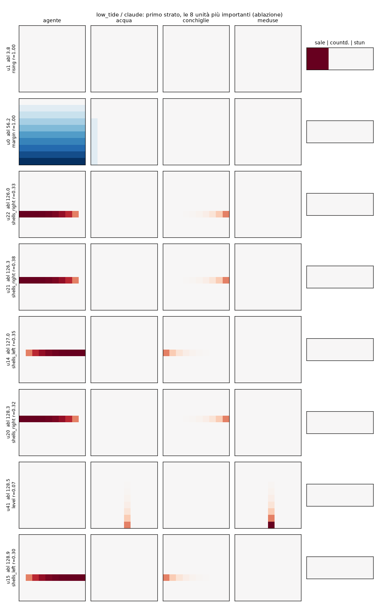
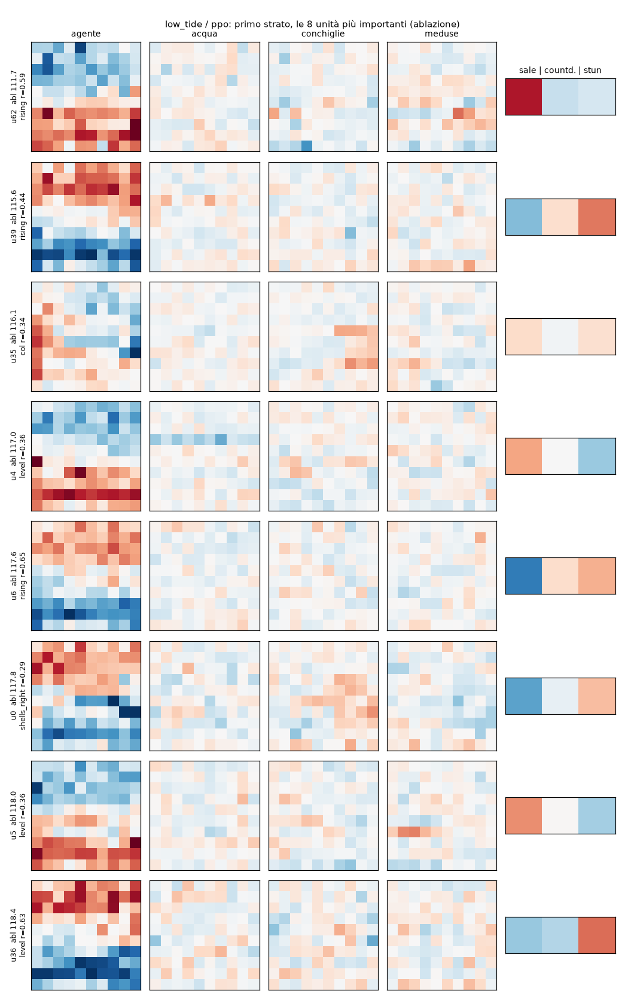

# PPO su Low Tide: che pesi trova, e si leggono?

`train.py` addestra con PPO una rete 403-64-64-5 tanh: due strati nascosti da 64 unità, il massimo che Low Tide
ammette. La salva in `weights/low_tide/ppo.json`, lo stesso formato delle reti scritte a mano. `analyze.py` fa le
stesse misure sulla rete PPO e sulle due reti scritte a mano, `claude.json` e `gpt.json`. Di queste ultime
conosciamo l'algoritmo neurone per neurone ([`decode_claude`](../decode_claude/README.md),
[`decode_gpt`](../decode_gpt/README.md)), quindi fanno da termine di paragone: mostrano che aspetto hanno, con
queste misure, dei pesi che *sono* un algoritmo.

**In breve.**

- **Come gioca:** PPO impara a giocare bene quanto le reti scritte a mano. Giocando sempre la mossa più probabile fa
  139 punti, più dei 132 della rete di Claude.
- **Come sono i pesi:** non si leggono come un algoritmo.
  - Sono densi, con 25.000 valori diversi nel primo strato.
  - Nessun neurone conta da solo.
  - Nessun neurone calcola le quantità che usa l'algoritmo di Claude (il margine dall'acqua, "c'è una conchiglia a
    destra").
  - Il comportamento non si comprime in una regola corta: un albero di decisione con 442 foglie lo imita solo nel
    77% degli stati.
- **L'unica traccia leggibile:** i neuroni più importanti del primo strato pesano soprattutto la **riga
  dell'agente** combinata con la **direzione della marea**. È una versione sfumata del "pericolo" che la rete di
  Claude calcola esattamente.

```bash
uv run --group ppo python experiments/low_tide/ppo/train.py          # ~16 min su un core
uv run --group analysis python experiments/low_tide/ppo/analyze.py   # ~30 min con 2 processi
```

## 1. L'addestramento

L'algoritmo è in `src/small_games/ppo.py`: PPO standard con clipping e GAE, come `ppo.py` di CleanRL.

| | |
|---|---|
| rete (attore) | 403-64-64-5, tanh; esportata così com'è |
| critico | 403-64-64-1, tanh; non esportato |
| ambienti | 64 in parallelo, rollout da 128 passi (8192 passi per aggiornamento) |
| ottimizzazione | 4 epoche, 8 minibatch, Adam lr 5·10⁻⁴ che scende a 0, clip 0.2 |
| ritorni | γ 0.99, λ 0.95; un episodio tagliato a 1000 passi è chiuso con il valore stimato, non come fine partita |
| esplorazione | coefficiente di entropia 0.01 |
| durata | 20 milioni di passi, 16 minuti |
| ambiente | quello della valutazione: sticky actions 0.1, 1000 passi; seed da 1.000.000 in su, mai quelli della valutazione |

Ritorno medio degli episodi durante l'addestramento:

| passi | 1.1M | 4.8M | 9.7M | 14.7M | 19.6M |
|---|---|---|---|---|---|
| ritorno | 65 | 87 | 97 | 114 | 130 |

La curva sale ancora alla fine: con più passi la rete migliorerebbe probabilmente ancora.

### Punteggio

Sono 500 episodi del protocollo (seed 10000-10499, sticky actions 0.1).

- **Campionata:** la mossa è estratta dalla softmax dei logit, come nel protocollo.
- **Greedy:** sempre la mossa più probabile.

| rete | campionata | greedy | senza sticky, greedy | conchiglie | punture | annegamenti (campionata) |
|---|---|---|---|---|---|---|
| euristica (BFS) | 164.0 | | | | | |
| `claude.json` | 132.3 ± 0.9 | 129.6 | 136.8 | 154.0 | 21.7 | 4.2% |
| **`ppo.json`** | **125.7 ± 1.9** | **139.2** | **153.2** | 147.2 | 21.5 | 25.2% |
| `gpt.json` | 79.9 ± 1.0 | 76.3 | 93.0 | 86.6 | 6.7 | 15.6% |

PPO raccoglie quasi le stesse conchiglie della rete di Claude, ma annega molto più spesso. Campionando sceglie a volte
mosse poco probabili e annega nel 25% degli episodi; giocando greedy annega nel 16% e supera la rete di Claude.
Senza sticky actions e giocando greedy annega comunque nel 4.8% degli episodi; le reti di Claude e di GPT, nelle
stesse condizioni, mai.

## 2. Com'è fatto un peso PPO

| | `claude.json` | `gpt.json` | `ppo.json` |
|---|---|---|---|
| pesi diversi da zero | 4.3% | 4.6% | 100% |
| valori diversi nel primo strato | 34 | 9 | 25.004 |
| ingressi che fanno il 90% del peso di un neurone (mediana, primo strato) | 9 su 403 | 2 | 240 |
| peso più grande (in valore assoluto) | 1023 | 1000 | 1.25 |

Ogni neurone del primo strato scritto a mano guarda pochi ingressi scelti, con valori tondi e spesso enormi: potenze
di 2, ±1000. Ogni neurone PPO guarda più di metà dell'osservazione, con pesi piccoli e tutti diversi.

Le immagini mostrano i pesi del primo strato degli 8 neuroni più importanti (quelli la cui ablazione fa perdere più
punti, sezione 4): una riga per neurone, un pannello per piano dell'osservazione (rosso positivo, blu negativo).

**Rete di Claude:** si vedono i confronti in binario della sezione 4 di `decode_claude`, per esempio "conchiglia a
destra nella riga r": l'agente nella riga r con pesi crescenti da destra, le conchiglie della stessa riga con potenze
di 2.



**Rete PPO:**



Nel piano dell'agente c'è una struttura: i pesi dipendono soprattutto dalla **riga**, positivi in alto e negativi in
basso o viceversa. Insieme al peso sull'ingresso "la marea sale", nell'ultimo pannello, è una misura sfumata di
"quanto sono vicino all'acqua, e l'acqua sta salendo?". Nei piani di acqua, conchiglie e meduse i pesi sembrano
rumore: piccoli, di segno variabile, senza una forma riconoscibile. Ogni neurone mescola un po' di tutto.

## 3. Quanti pesi servono (pruning)

Si tengono solo i pesi più grandi in valore assoluto, la stessa frazione in ogni strato, e si rimette la rete a
giocare. Sono 200 episodi.

| pesi tenuti | 100% | 50% | 25% | 10% | 5% | 2% |
|---|---|---|---|---|---|---|
| `claude.json` | 132.1 | 132.1 | 132.1 | 34.3 | 34.3 | 1.0 |
| `gpt.json` | 79.7 | 79.7 | 79.7 | 42.8 | 1.2 | 1.2 |
| `ppo.json` | 125.5 | 103.9 | 11.5 | 5.3 | 6.6 | 2.6 |

Le reti scritte a mano sono già sparse: togliere il 75% dei pesi più piccoli toglie solo zeri. La rete PPO perde
già con metà dei pesi, e con un quarto non gioca più. La sua informazione è spalmata su tutti i pesi.

## 4. Quanto conta ogni neurone (ablazione)

Si sostituisce un neurone, a ogni passo, con il valore che aveva in un altro stato preso a caso (resample
ablation), e si misura quanti punti si perdono. Sono 100 episodi per neurone; l'errore standard del riferimento è
±1.5 per Claude, ±2.0 per GPT e ±4.4 per PPO.

| | neuroni | neuroni che fanno perdere più del 10% | perdita massima | quota dei 5 neuroni peggiori sulla perdita totale |
|---|---|---|---|---|
| `claude.json` | 82 | 7 | 129 punti su 133 | 72% |
| `gpt.json` | 157 | 35 | 78 su 82 | 23% |
| `ppo.json` | 128 | **0** | 12 su 124 | 20% |

Nella rete di Claude pochi neuroni portano la strategia: senza "la marea sale" la rete fa 3.8 punti, senza "sale e
margine ≤ 1" 9.6, senza il margine dall'acqua 56. I sette neuroni sopra il 10% sono proprio le grandezze e le
condizioni dell'algoritmo. Nella rete PPO nessun neurone conta più del rumore
statistico: il calcolo è distribuito.

## 5. Cosa calcolano i neuroni

### Le quantità dell'algoritmo di Claude

L'algoritmo di Claude si basa su poche quantità: il margine dall'acqua, il pericolo ("la marea sale e il margine è
≤ 2"), "c'è una conchiglia a destra o a sinistra nella mia riga". Per ogni quantità e ogni rete si misurano due
cose, sugli stati visitati dalla rete stessa:

- **un neurone:** la correlazione più alta tra la quantità e un singolo neurone (|r|). Vale 1 se un neurone *è* la
  quantità;
- **tutto lo strato:** quanto bene la ricostruisce una combinazione lineare di tutti i neuroni di uno strato (R², su
  episodi non usati per la combinazione). È alto se la quantità c'è, anche se spalmata su molti neuroni.

Per ogni quantità si riporta lo strato migliore:

| quantità | `claude.json` (r / R²) | `gpt.json` (r / R²) | `ppo.json` (r / R²) |
|---|---|---|---|
| margine dall'acqua | **1.00 / 1.00** | 0.62 / **1.00** | 0.33 / 0.48 |
| pericolo (sale e margine ≤ 2) | **0.90 / 1.00** | **1.00 / 1.00** | 0.77 / 0.71 |
| conchiglia a destra nella riga | **1.00 / 1.00** | 0.64 / 0.64 | 0.29 / 0.27 |
| conchiglia a sinistra nella riga | **1.00 / 1.00** | 0.41 / 0.46 | 0.49 / 0.41 |

La rete di GPT non calcola "c'è una conchiglia a destra" perché il suo algoritmo è un altro: un'attrazione che cala
con la distanza (`decode_gpt`). Calcola però esattamente il margine e il pericolo. La rete PPO non ha nessuna di
queste quantità in modo pulito, nemmeno spalmata su tutto lo strato. Il pericolo è la più vicina (r 0.77).

### Neuroni booleani o graduati

| | primo strato | secondo strato |
|---|---|---|
| `claude.json`: neuroni tanh saturi (\|a\| > 0.95) | relu | 100% |
| `ppo.json`: neuroni tanh saturi | 3% | 24% |

Nella rete di Claude il secondo strato è fatto di condizioni vero/falso. Nella rete PPO quasi nessun neurone lavora
come un interruttore.

### Con il vocabolario del gioco

Il gioco ha un vocabolario di 17 grandezze, in `src/small_games/features.py`: riga, colonna, livello, marea che
sale, countdown, stordimento, margine, conchiglie nelle quattro direzioni, conchiglia più vicina, meduse adiacenti.
Il neurone PPO meglio spiegato da una sola di queste ha |r| = 0.80; solo 1 neurone su 128 supera 0.8. In ciascuno
dei due strati, per 57 neuroni su 64 la grandezza che li spiega meglio è il **livello** dell'acqua, la **marea che
sale**, la riga o la colonna. Per gli altri 7 è una grandezza delle conchiglie, sempre con correlazioni basse. Una combinazione lineare di tutte le 17 grandezze spiega in media il 35-44% della varianza di un neurone
PPO. Ogni neurone è una miscela.

## 6. Si può scrivere come regola? (distillazione)

Un albero di decisione sulle 17 grandezze impara a imitare la mossa più probabile della rete. Si allena sul 70%
degli episodi e si misura l'accordo sul restante 30%. Poi l'albero gioca da solo al posto della rete, 200 episodi.

| profondità | `claude.json` accordo / foglie / punti | `gpt.json` | `ppo.json` |
|---|---|---|---|
| 4 | 90.4% / 16 / 15.6 | 82.9% / 16 / 49.2 | 59.9% / 16 / 4.7 |
| 6 | **99.6%** / 47 | 92.2% / 53 | 64.2% / 53 |
| 8 | 99.6% / 73 / 117.0 | 95.2% / 115 / 61.9 | 72.6% / 136 / 84.6 |
| 12 | 99.6% / 92 / 117.0 | 96.5% / 242 / 68.3 | 77.0% / 442 / 112.3 |
| la rete stessa, greedy | 127.4 | 74.0 | 138.7 |

- **Claude:** il comportamento è una regola di 47 foglie, sulle stesse grandezze dell'algoritmo trovato a mano.
- **GPT:** il comportamento è quasi una regola. Il resto è l'attrazione per distanza, che queste grandezze
  descrivono solo in parte.
- **PPO:** non ci si avvicina. Con 442 foglie l'albero sbaglia ancora una mossa su quattro. Gioca comunque
  discretamente (112 punti): imita le parti importanti, non la rete.

Gli alberi di profondità 2-4 sono in `results/analysis/trees_<rete>.txt`.

## 7. Conclusione

- **Le reti scritte a mano:** i pesi sono il programma. Ogni neurone ha un nome ("margine", "conchiglia a destra
  nella riga 5"), pochi neuroni portano tutta la strategia e il comportamento è una regola corta sulle quantità del
  gioco.
- **PPO:** trova una soluzione che gioca bene quanto quelle (meglio, se greedy), ma che non ha questa forma:
  - i pesi sono densi e continui;
  - il calcolo è distribuito su tutti i neuroni;
  - le quantità "naturali" del gioco non compaiono come neuroni e solo in parte come combinazioni di neuroni;
  - il comportamento non si riassume in una regola corta.

Una descrizione parziale si può dare. I neuroni più importanti del primo strato combinano la riga dell'agente con la
direzione della marea, cioè una versione sfumata di "sto per finire sott'acqua?". Quasi tutti i neuroni seguono
soprattutto livello, marea e posizione. La strategia di raccolta, invece, non si lascia ridurre a
quantità con un nome.

## File

- `train.py`: configurazione e lancio dell'addestramento.
- `analyze.py`: tutte le misure; con `--only-key` solo le quantità chiave.
- `results/ppo/`:
  - `train_log.csv`: la curva di addestramento;
  - `checkpoint_*.json`: i pesi al 10, 25 e 50% dell'addestramento;
  - `eval.json`: le valutazioni;
  - `final.pt`: attore e critico in formato PyTorch.
- `results/analysis/`:
  - `analysis.json`: tutti i numeri;
  - `trees_*.txt`: gli alberi;
  - `fields_*.png`: le immagini del primo strato.
