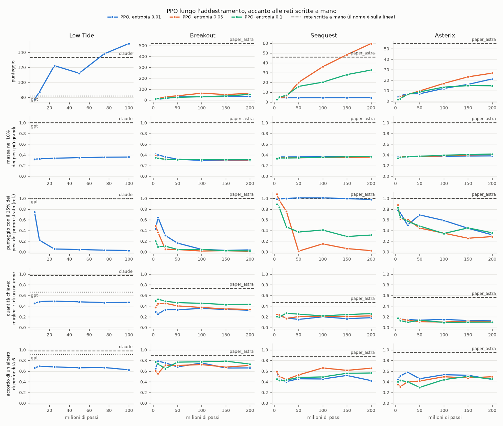

# PPO over training: do the weights become sparser or more readable?

The analyses in `experiments/<game>/ppo/` look at a single PPO network per game, at the end of training, and
find it dense and unreadable. This could depend on when training stops (perhaps with more steps the network "cleans up") or
on the chosen entropy coefficient. Here the main measures, in a lightweight version, run on all PPO runs and
on their checkpoints:

- **MinAtar games:** the three 200M-step runs with entropy 0.01, 0.05 and 0.1, at 5, 10, 25, 50, 100, 150 and 200M
  steps;
- **Low Tide:** the 100M-step run, at 5, 10, 25, 50, 75 and 100M;
- alongside, the hand-written networks of the same game.

**In short: no.** In all runs and at every checkpoint the PPO weights stay far from the hand-written ones, and the
distance does not shrink as the network learns.

- **Concentration:** the largest 10% of the weights carry 30-40% of the sum of |w|, from the first to the last
  checkpoint. In the hand-written networks 100%; in random Gaussian weights 26%.
- **Inputs per neuron:** each first-layer neuron uses 53-63% of the live inputs to make up 90% of its
  weight, with a slow decline during training. The hand-written networks 1-3% (35% for Breakout, where each
  neuron is a table over the whole grid).
- **Pruning:** the more the network learns, the less it withstands it. With 25% of the live first-layer weights the early checkpoints
  keep most of their score (which is low); the last ones keep 1-36% of it. The hand-written networks 100%.
- **Quantities of the hand-written algorithm:** the best |r| of a neuron, averaged over the quantities, stays flat
  (0.10-0.53) and always below that of the hand-written networks of the same game (0.47-0.97).
- **Rule:** the agreement of a depth-6 tree stays between 29 and 79%, with no trend; the hand-written networks
  87-98%.
- **Entropy:** it changes how much and when PPO learns, not the shape of the weights. The three runs of each game have
  close curves in all measures except the score and pruning, which depends on how much the network has learned.

The only apparent exception is Seaquest with entropy 0.01: it withstands pruning at 100% throughout training, but
only because it scores 4.4 points from start to end and has nothing to lose.

```bash
uv run --group analysis python experiments/ppo_over_training/analyze.py               # ~5 min with 8 processes
uv run --group analysis python experiments/ppo_over_training/analyze.py --plot-only   # figure and tables only
```

First run each game's `analyze.py`: the live inputs come from there.

## The measures

The first layer is examined only on the game's **live inputs**, those that are non-zero in at least one state
played by the networks analyzed in `experiments/<game>/ppo/` (220 of 600 in Breakout, 425 in Seaquest, 315 in
Asterix, 312 of 403 in Low Tide). On the other inputs PPO receives no gradient and leaves the initialization weights, which
would inflate the density measures without saying anything about what it has learned.

| measure | what it says | for a hand-written network |
|---|---|---|
| score | mean over 100 protocol episodes, sampled | |
| mass in 10% of the weights | share of the sum of \|w\| (all layers) that lies in the largest 10% of the weights | 100%: the non-zero weights are fewer than 10% |
| live inputs for 90% | median, over the first-layer neurons, of the fraction of live inputs that makes up 90% of their \|w\| | few |
| first layer at 25% | score keeping the largest 25% of the live first-layer weights, divided by the score | 100% |
| key quantities: best \|r\| | mean, over the quantities of the hand-written algorithm (`KEY_QUANTITIES` in `analysis.py`), of the highest correlation with a single neuron | high |
| depth-6 tree | agreement with the network's most likely move, on the 30% of the episodes not used to build it | high |

The quantities and the trees use 10 episodes played by the network; the values are a bit noisier than those of the
full analyses (40 episodes), but they match them within a few points.

## Results



Each column is a game, each row a measure. The colored lines are the PPO runs (the color is the entropy
coefficient), the dashed gray lines the hand-written networks.

The first and last checkpoint of each run (all checkpoints in `results/sweep.md`):

| game | network | score | mass in 10% | live inputs for 90% | first layer at 25% | key quantities: \|r\| | depth-6 tree |
|---|---|---|---|---|---|---|---|
| low_tide | `claude` (hand-written) | 133.0 | 100% | 3% | 100% | 0.97 | 98% |
| low_tide | `gpt` (hand-written) | 81.9 | 100% | 1% | 100% | 0.66 | 91% |
| low_tide | `ppo_100m` 5M | 77.4 | 32% | 61% | 75% | 0.45 | 66% |
| low_tide | `ppo_100m` 100M | 151.8 | 36% | 55% | 3% | 0.47 | 62% |
| breakout | `paper_astra` (hand-written) | 518.5 | 100% | 35% | 100% | 0.73 | 89% |
| breakout | `ppo_ent01` 5M | 6.4 | 41% | 61% | 43% | 0.30 | 65% |
| breakout | `ppo_ent01` 200M | 35.3 | 29% | 62% | 4% | 0.32 | 66% |
| breakout | `ppo_ent05` 5M | 11.1 | 39% | 61% | 49% | 0.38 | 61% |
| breakout | `ppo_ent05` 200M | 61.8 | 30% | 62% | 1% | 0.34 | 71% |
| breakout | `ppo_ent10` 5M | 12.4 | 35% | 63% | 20% | 0.50 | 78% |
| breakout | `ppo_ent10` 200M | 51.3 | 31% | 60% | 2% | 0.43 | 73% |
| seaquest | `paper_astra` (hand-written) | 45.7 | 100% | 2% | 100% | 0.47 | 87% |
| seaquest | `ppo_ent01` 5M | 4.3 | 36% | 62% | 99% | 0.22 | 61% |
| seaquest | `ppo_ent01` 200M | 4.5 | 37% | 59% | 98% | 0.18 | 42% |
| seaquest | `ppo_ent05` 5M | 3.6 | 35% | 62% | 108% | 0.25 | 59% |
| seaquest | `ppo_ent05` 200M | 59.6 | 36% | 56% | 2% | 0.22 | 65% |
| seaquest | `ppo_ent10` 5M | 2.7 | 33% | 62% | 89% | 0.20 | 45% |
| seaquest | `ppo_ent10` 200M | 32.6 | 37% | 56% | 32% | 0.26 | 57% |
| asterix | `paper_astra` (hand-written) | 55.0 | 100% | 3% | 100% | 0.56 | 94% |
| asterix | `ppo_ent01` 5M | 3.9 | 36% | 61% | 78% | 0.18 | 45% |
| asterix | `ppo_ent01` 200M | 21.1 | 38% | 53% | 32% | 0.12 | 44% |
| asterix | `ppo_ent05` 5M | 2.2 | 34% | 62% | 88% | 0.17 | 35% |
| asterix | `ppo_ent05` 200M | 26.7 | 40% | 53% | 29% | 0.11 | 49% |
| asterix | `ppo_ent10` 5M | 1.6 | 34% | 62% | 83% | 0.18 | 40% |
| asterix | `ppo_ent10` 200M | 14.6 | 41% | 54% | 36% | 0.10 | 45% |

(A value above 100% in pruning is noise: with 100 episodes the pruned network can do a little better than the full one.)

## What we learn from it

PPO, with this architecture and with no pressure toward small or few weights, always finds dense solutions:
gradient descent moves every weight a little, and nothing pushes the useless ones to zero. During training the
network does not converge toward a sparse form; on the contrary, as it improves it uses more weights, and pruning costs it
more. The hand-written networks are sparse because whoever writes them starts from an algorithm and translates it into a few
connections; PPO does not start from an algorithm, and does not find one along the way.

A sparse PPO network could be sought explicitly, for example with an L1 penalty on the weights or with pruning and
retraining. That would be another experiment: here the question was what the solution that PPO finds on its own looks like.

## Files

- `analyze.py`: the measures on all checkpoints, the figure and the tables.
- `results/sweep.json`: all the numbers.
- `results/sweep.md`: the tables, all checkpoints.
- `results/sweep.png`: the figure.
