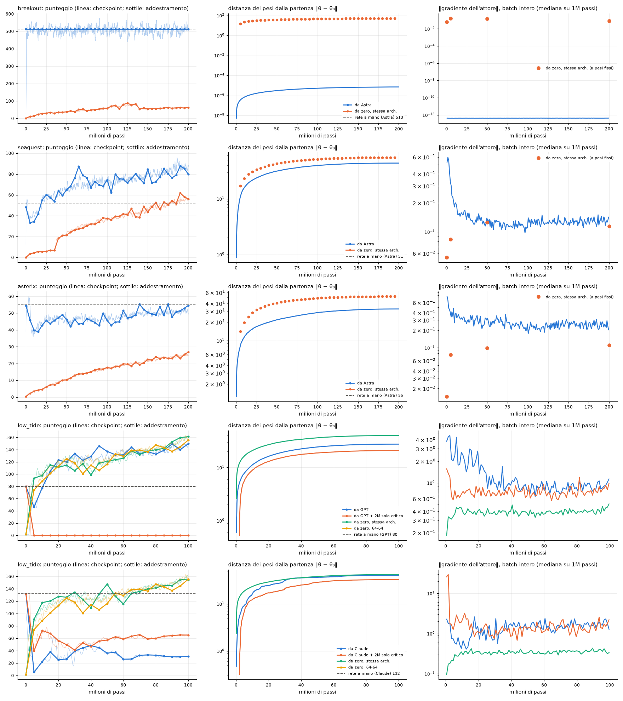

# PPO che parte dalle reti scritte a mano: sono buone inizializzazioni?

Le reti scritte dagli LLM sono algoritmi leggibili (vedi `experiments/<gioco>/decode_*`). Qui sono il punto di
partenza dell'attore di PPO, e le domande sono:

- l'addestramento le migliora, e di quanto?
- dopo quanti passi?
- quanto tempo fa risparmiare rispetto a partire da zero?
- che gradiente vede PPO in quel punto? È vicino a zero, cioè un plateau dove l'addestramento non le muove?
- di quanto si muovono i pesi?

**Le corse.** Ogni corsa usa la configurazione della migliore corsa da zero del gioco e cambia solo il punto di
partenza dell'attore. Il critico parte casuale.

- **Breakout, Seaquest, Asterix** (`ppo_from_astra`): parte da `paper_astra.json`, ha l'architettura 600-32-32-6
  tanh e fa 200M passi.
  - Le dieci corse da zero di `experiments/ppo_runs.py` cambiavano il coefficiente di entropia, non il learning rate,
    che è 5e-4 in tutte.
  - Le migliori, in tutti e tre i giochi, sono quelle con entropia 0.05 (`ppo_ent05`), che fanno da riferimento.
- **Low Tide** (`ppo_from_gpt`, `ppo_from_claude`): parte da `gpt.json` (43-61-53 relu) o da `claude.json` (46-36
  relu/tanh).
  - Usa la configurazione di `ppo_100m`: entropia 0.01, lr 5e-4, 100M passi.
  - Le reti scritte a mano hanno un'altra architettura, quindi il riferimento è una corsa da zero con la stessa
    architettura (`ppo_arch_gpt`, `ppo_arch_claude`).
  - C'è anche una variante `_cw`, in cui i primi 2M passi addestrano solo il critico: l'attore resta la rete scritta
    a mano finché il critico non ha imparato il suo valore.

Gli iperparametri comuni sono: 64 ambienti × 128 passi, 4 epoche × 8 minibatch, Adam (eps 1e-5), clipping del
gradiente a 0.5 e lr che scende linearmente a 0.

**In breve: le reti di Astra sui giochi MinAtar sì, le reti di GPT e Claude su Low Tide no.**

- **Breakout:** la rete di Astra è un plateau vero. Il gradiente è 4·10⁻¹³, contro 0.06-0.16 di PPO da zero. In
  200M passi i pesi si muovono di 7·10⁻⁶, e la rete finale gioca esattamente come quella di partenza (512.5).
  - Non è un ottimo: la softmax è satura (entropia 0, probabilità 1 in float32), quindi PPO non esplora e non vede
    nessun segnale.
  - Il punto di partenza vale comunque 8 volte la migliore corsa da zero (63.2).
- **Seaquest:** il punteggio scende da 51 a 33 nei primi 5M passi. Torna al livello di Astra a 20M passi e finisce a
  **82.5 (+60%)**, sopra tutto ciò che PPO da zero raggiunge (55.9).
  - Per arrivare al 95% del finale da zero risparmia 150M passi, circa 1.4 ore su un core.
- **Asterix:** il punteggio scende da 55 a 39 e risale lentamente fino a **50.8 (−7%)**. PPO non migliora la rete di
  Astra, ma il punto di partenza resta il doppio della corsa da zero (24.6).
- **Low Tide:** PPO distrugge le reti scritte a mano nel primo milione di passi.
  - GPT scende da 80 a 1 e risale fino a **147.3 (+84%)**. Resta però sotto la corsa da zero con la stessa
    architettura (166.9), che arriva a 147 a 90M passi: partire da GPT fa perdere tempo invece di risparmiarlo.
  - Claude scende da 132 a 6 e non si riprende più: finisce a **31.0 (−77%)**, contro 158.4 da zero.
  - Addestrare prima solo il critico non risolve il problema. Claude finisce a 66.6, meglio ma sempre peggio di
    partire da zero e della rete di partenza. GPT si blocca su una policy che non segna mai: 0.0 da 4M passi alla fine.
- **Gradiente:** a parte Breakout, nessuna rete a mano sta su un plateau. Il gradiente dell'attore è 3-80 volte
  quello che PPO vede durante il suo addestramento.
- **Movimento dei pesi:** in valore assoluto si muovono quanto in una corsa da zero (21-44 contro 40-55 in norma L2).
  - Rispetto ai loro pesi, che sono enormi (‖θ‖ da 500 a 45.000 contro 11-17 di un'inizializzazione casuale), è poco:
    lo 0.07-9%.
  - Basta però a cambiare la policy: alla fine scelgono la stessa mossa della rete di partenza solo nel 15-68% degli
    stati.
  - I pesi a zero della rete a mano diventano diversi da zero per il 42-80%: la rete non è più sparsa né leggibile.

**Perché su Low Tide crolla.** Con pesi così grandi la rete sta in una zona molto ripida. Lo stesso passo di Adam,
circa lr su ogni peso, cambia la policy molto più che partendo da pesi piccoli.

- Nel primo milione di passi il KL fra la policy prima e dopo un aggiornamento (mediana) è:
  - **Low Tide:** 0.23 partendo da GPT e 0.070 da Claude, contro 0.004-0.005 da zero. È 20-45 volte di più, e la
    policy di partenza è cancellata prima che il critico serva a qualcosa.
  - **Seaquest e Asterix:** 0.0045 e 0.0057, contro 0.0012-0.0014 da zero, cioè 3-5 volte. Qui le reti di Astra
    sopravvivono.
- Sui giochi MinAtar conta anche l'entropia: il bonus 0.05, scelto per le corse da zero, spinge le reti quasi
  deterministiche di Astra verso il caso.
  - Su Asterix la parte di entropia del gradiente iniziale (0.95) è grande quasi quanto quella di policy gradient
    (1.06).
  - L'entropia sale da 0.19 a 0.69 su Seaquest e da 0.31 a 0.69 su Asterix.
  - Il calo iniziale dei due giochi viene probabilmente da qui: è un'ipotesi, non l'abbiamo isolata con una corsa a
    entropia più bassa.

```bash
uv run python experiments/ppo_runs.py start breakout/ppo_from_astra seaquest/ppo_from_astra asterix/ppo_from_astra \
    low_tide/ppo_from_gpt low_tide/ppo_arch_gpt low_tide/ppo_from_gpt_cw \
    low_tide/ppo_from_claude low_tide/ppo_arch_claude low_tide/ppo_from_claude_cw   # ~2 ore su 9 core
uv run --group ppo python experiments/ppo_warm_start/probe.py          # gradiente a pesi fissi, ~1 min per rete
uv run --group ppo --group analysis python experiments/ppo_warm_start/analyze.py --workers 8   # pochi minuti
```

`analyze.py` scrive in `results/`:

- `tables.md`: tutte le tabelle, anche quelle complete;
- `curves.png`: il grafico;
- `summary.json`: tutti i numeri;
- `scores.json`: la cache delle valutazioni.

I pesi finali sono in `weights/<gioco>/ppo_from_*.json` e `ppo_arch_*.json`. Log, checkpoint ogni 5M passi e
valutazione finale sono in `experiments/<gioco>/ppo/results/<corsa>/`.

## Le misure

- **Punteggi.**
  - Inizio e fine usano il protocollo completo: 1000 episodi per MinAtar, 500 per Low Tide.
  - Lungo la corsa, ogni checkpoint (ogni 5M passi) è valutato su 200 episodi. I tempi ("torna al livello a", "+10%
    a", "supera la soglia a") sono il primo checkpoint che ci arriva, quindi hanno una risoluzione di 5M passi.
  - La curva di addestramento (media degli episodi finiti negli ultimi 1M passi) vede anche i crolli fra due
    checkpoint, ma è più rumorosa. Su Breakout la policy non cambia, eppure la curva oscilla del ±15%.
  - Di questa curva non si usa il primo milione di passi: lì finiscono solo gli episodi brevi, che sono quelli
    andati male.
- **Risparmio.** La soglia è il 95% del punteggio finale della corsa da zero. Il risparmio è la differenza fra i passi
  che servono alla corsa da zero e alla corsa dalla rete a mano per superarla. Le ore sono quelle della corsa da
  zero: un core per corsa, ~1.8 h per 200M passi MinAtar e ~0.85 h per 100M passi Low Tide.
- **Gradiente durante l'addestramento.** `ppo.py` registra due norme del gradiente dell'attore, prima del clipping:
  - **sul minibatch** a ogni aggiornamento;
  - **sul batch intero** di 8192 passi ogni `log_every` aggiornamenti, divisa in parte policy gradient e parte
    entropia.

  Registra anche la frazione di minibatch tagliati dal clipping e ‖θ − θ₀‖.
- **Gradiente a pesi fissi** (`probe.py`).
  - Per ogni rete PPO gira 2M passi con l'attore fermo: il critico impara il valore di quella policy, e il log
    registra il gradiente dell'attore senza mai applicarlo.
  - Il valore riportato è la media dell'ultimo quarto, con il critico ormai adattato.
  - Così si confrontano alla pari:
    - le reti scritte a mano;
    - l'inizializzazione casuale di PPO;
    - le reti PPO a metà e alla fine dell'addestramento;
    - le reti finali delle corse dai pesi a mano.
- **Movimento.**
  - ‖θ_fine − θ₀‖ su tutti i pesi dell'attore, in assoluto, relativo a ‖θ₀‖ e per strato.
  - Quanti pesi nulli nella rete a mano sono ora diversi da zero (|w| > 10⁻³).
  - Accordo fra la mossa più probabile della rete finale e quella della rete a mano, su 40.000 stati giocati dalla
    rete a mano o dalla rete finale.

## Risultati



Una riga per ogni rete a mano: la linea tratteggiata è il suo punteggio. Per Low Tide c'è anche la corsa da zero
64-64 (`ppo_100m`).

- **Prima colonna:** il punteggio dei checkpoint (linea con punti) e la curva di addestramento (linea sottile).
- **Seconda colonna:** la distanza dei pesi dalla partenza. Per le corse da zero dei giochi MinAtar, lanciate prima
  che `ppo.py` la registrasse, è calcolata dai checkpoint.
- **Terza colonna:** la norma del gradiente dell'attore sul batch intero, mediana su 1M passi. Per le stesse corse
  MinAtar viene da `probe.py`, misurata a pesi fissi.

### Quanto migliora

| gioco | partenza | crollo iniziale (curva di addestramento) | checkpoint peggiore | torna al livello della rete a mano a | +10% a | miglior checkpoint | fine | fine − partenza | da zero, stessa arch. |
|---|---|---|---|---|---|---|---|---|---|
| Breakout | Astra 512.5 | - (la policy non cambia) | 512.7 | non scende | mai | 512.7 | 512.5 ± 7.6 | +0.0 (0%) | 63.2 ± 1.0 |
| Seaquest | Astra 51.4 | 36.9 a 4.9M | 33.3 a 5M | 20M | 25M | 87.6 a 190M | 82.5 ± 2.1 | **+31.0 (+60%)** | 55.9 ± 1.3 |
| Asterix | Astra 54.8 | 36.0 a 8.9M | 38.9 a 15M | 140M (con rumore) | mai | 55.4 a 175M | 50.8 ± 1.0 | −4.0 (−7%) | 24.6 ± 0.5 |
| Low Tide | GPT 79.9 | 1.3 a 1.1M | 46.1 a 5M | 15M | 15M | 149.5 a 100M | 147.3 ± 2.9 | **+67.3 (+84%)** | 166.9 ± 2.7 |
| Low Tide | GPT, 2M solo critico | 0.0 a 4.2M | 0.0 a 5M | mai | mai | 79.7 a 0 | 0.0 ± 0.0 | −79.9 (−100%) | 166.9 ± 2.7 |
| Low Tide | Claude 132.3 | 6.3 a 5.7M | 5.4 a 5M | mai | mai | 132.1 a 0 | 31.0 ± 0.3 | −101.2 (−77%) | 158.4 ± 2.9 |
| Low Tide | Claude, 2M solo critico | 38.4 a 4.3M | 39.8 a 5M | mai | mai | 132.1 a 0 | 66.6 ± 0.6 | −65.7 (−50%) | 158.4 ± 2.9 |

### Quanto tempo si risparmia

| gioco | partenza | soglia (95% del finale da zero) | dalla rete a mano la supera a | da zero la supera a | risparmio | da zero raggiunge la rete a mano a | da zero raggiunge il finale di questa corsa a |
|---|---|---|---|---|---|---|---|
| Breakout | Astra | 60.1 | 0 | 105M | 105M passi ≈ 0.9 h | mai (in 200M) | mai |
| Seaquest | Astra | 53.1 | 20M | 170M | **150M passi ≈ 1.4 h** | 160M | mai |
| Asterix | Astra | 23.4 | 0 | 160M | 160M passi ≈ 1.4 h | mai (in 200M) | mai |
| Low Tide | GPT | 158.5 | mai | 95M | nessuno: non ci arriva | 5M | 90M |
| Low Tide | GPT, 2M solo critico | 158.5 | mai | 95M | nessuno | 5M | 0 |
| Low Tide | Claude | 150.4 | mai | 95M | nessuno | 30M | 5M |
| Low Tide | Claude, 2M solo critico | 150.4 | mai | 95M | nessuno | 30M | 5M |

Su Breakout e Asterix il risparmio è un limite inferiore: la corsa da zero non arriva mai alla rete di partenza, e
la corsa dai pesi a mano parte già sopra la soglia.

### Il gradiente: plateau o no?

Gradiente dell'attore sul batch intero, a pesi fissi e con il critico adattato, prima del clipping. Tabella completa
in `results/tables.md`.

| gioco | rete | entropia | ‖θ‖ | ‖g‖ | di cui policy gradient / entropia | ‖g‖ / ‖θ‖ |
|---|---|---|---|---|---|---|
| Breakout | Astra (a mano) | 0.000 | 3588 | **4.2·10⁻¹³** | 1.2·10⁻¹⁴ / 4.2·10⁻¹³ | 10⁻¹⁶ |
| | inizializzazione casuale | 1.099 | 11.3 | 0.060 | 0.060 / 0.0001 | 0.005 |
| | PPO da zero a 5M / 50M / 200M | 0.53-0.76 | 174-181 | 0.164 / 0.144 / 0.085 | | 0.0005-0.0009 |
| Seaquest | Astra (a mano) | 0.143 | 498 | **0.367** | 0.344 / 0.096 | 0.0007 |
| | inizializzazione casuale | 1.792 | 11.3 | 0.055 | | 0.005 |
| | PPO da zero a 5M / 50M / 200M | 1.23-1.48 | 21-57 | 0.084 / 0.126 / 0.115 | | 0.002-0.004 |
| | dalla rete a mano, fine | 0.685 | 500 | 0.131 | | 0.0003 |
| Asterix | Astra (a mano) | 0.286 | 1760 | **1.14** | 1.06 / 0.95 | 0.0006 |
| | inizializzazione casuale | 1.609 | 11.3 | 0.015 | | 0.001 |
| | PPO da zero a 5M / 50M / 200M | 1.19-1.28 | 102-114 | 0.076 / 0.100 / 0.111 | | 0.001 |
| | dalla rete a mano, fine | 0.693 | 1451 | 0.289 | | 0.0002 |
| Low Tide | GPT (a mano) | 0.620 | 1600 | **1.32** | 1.31 / 0.075 | 0.0008 |
| | casuale, arch. di GPT | 1.609 | 16.7 | 0.025 | | 0.0015 |
| | da zero, arch. di GPT, fine | 0.414 | 43.7 | 0.409 | | 0.009 |
| | dalla rete a mano, fine | 0.291 | 1601 | 1.09 | | 0.0007 |
| | Claude (a mano) | 0.351 | 45621 | **28.3** | 28.3 / 1.09 | 0.0006 |
| | casuale, arch. di Claude | 1.609 | 12.8 | 0.042 | | 0.003 |
| | da zero, arch. di Claude, fine | 0.363 | 44.4 | 0.352 | | 0.008 |
| | dalla rete a mano, fine | 0.493 | 45621 | 1.88 | | 0.00004 |
| | 64-64 da zero (`ppo_100m`) a 5M / 50M / 100M | 0.38-0.45 | 27-57 | 0.237 / 0.235 / 0.252 | | 0.004-0.009 |

- **Breakout di Astra** è un plateau nel senso letterale: un gradiente 10¹¹ volte più piccolo di quello di una rete
  qualsiasi.
  - Adam ha eps = 10⁻⁵, e un gradiente così piccolo lo porta a passi di circa lr × 10⁻⁸ per peso.
  - Durante la corsa la norma resta 4·10⁻¹³ dal primo all'ultimo aggiornamento.
- **Le altre reti a mano** hanno un gradiente 3-80 volte più grande di quello che PPO vede alla fine del suo
  addestramento:
  - Seaquest: 0.37 contro 0.115;
  - Asterix: 1.14 contro 0.111;
  - GPT: 1.32 contro 0.409;
  - Claude: 28.3 contro 0.352.
- Diviso per ‖θ‖ il gradiente è piccolo (10⁻⁴-10⁻³), perché i pesi sono enormi. Ma Adam non guarda il rapporto:
  muove ogni peso di circa lr. Conta di quanto cambia la policy, ed è tanto, come mostra il KL qui sopra.
- **Con il critico casuale** del primo aggiornamento il gradiente è ancora più grande: 18.6 per GPT, contro 0.076
  da zero.
  - Il clipping (0.5 sulla norma congiunta di attore e critico) taglia il 100% dei minibatch nel primo milione di
    passi delle corse da Astra (Seaquest e Asterix) e da GPT, e il 79% di quella da Claude.
  - Ad Adam il clipping cambia poco, perché normalizza la scala.

### Quanto si muovono i pesi

| gioco | partenza | ‖θ₀‖ | ‖θ_fine − θ₀‖ | relativo | per strato | da zero: ‖θ_fine − θ₀‖ (relativo) | zeri della rete a mano ora ≠ 0 | stessa mossa della rete a mano (sui suoi stati / sui propri) |
|---|---|---|---|---|---|---|---|---|
| Breakout | Astra | 3588 | 7·10⁻⁶ | 0.00% | 0 · 0 · 0 | 51.2 (29%) | 0% | 100% / 100% |
| Seaquest | Astra | 498 | 43.9 | 8.8% | 34.7% · 8.1% · 0.5% | 55.5 (491%) | 51% | 37% / 56% |
| Asterix | Astra | 1451 | 32.6 | 2.3% | 13.8% · 7.1% · 0.1% | 52.0 (52%) | 42% | 68% / 70% |
| Low Tide | GPT | 1600 | 27.5 | 1.7% | 36.9% · 2.2% · 1.6% · 0.2% | 39.9 (239%) | 80% | 31% / 36% |
| Low Tide | GPT, 2M solo critico | 1600 | 20.8 | 1.3% | 28.2% · 1.8% · 0.9% · 0.3% | 39.9 (239%) | 68% | 15% / 0% |
| Low Tide | Claude | 45621 | 40.8 | 0.09% | 0.2% · 0.0% · 12.9% | 42.3 (330%) | 60% | 17% / 18% |
| Low Tide | Claude, 2M solo critico | 45621 | 32.9 | 0.07% | 0.2% · 0.0% · 8.9% | 42.3 (330%) | 60% | 18% / 24% |

- **Il primo strato** è quello che si muove di più nelle reti di Astra e di GPT. Contiene quasi tutti i pesi (600×32
  su 20.486 nei giochi MinAtar, 403×43 su 23.612 in GPT), e Adam muove ognuno di circa lr.
- **Claude** è l'eccezione: i primi due strati hanno norme 11.772 e 44.075, e in proporzione a muoversi è l'uscita.
- **La policy cambia molto:** Seaquest finisce a +60% scegliendo la mossa di Astra solo nel 37% dei suoi stati.
- **Breakout** è identica alla partenza: i pesi e quindi le mosse.

## Tutti i punteggi

Protocollo completo (1000 episodi MinAtar, 500 Low Tide), media ± errore standard. Tutte le corse PPO hanno lr 5e-4.

| modello | Breakout | Seaquest | Asterix |
|---|---|---|---|
| casuale | 0.5 ± 0.0 | 0.1 ± 0.0 | 0.5 ± 0.0 |
| **Astra, scritta a mano** (`paper_astra`) | **512.5 ± 7.6** | 51.4 ± 1.4 | **54.8 ± 1.1** |
| PPO da zero, entropia 0.01, 30M passi (`ppo_v1`) | 5.8 ± 0.0 | 5.4 ± 0.1 | 9.1 ± 0.2 |
| PPO da zero, entropia 0.01, 200M (`ppo_ent01`) | 34.7 ± 0.5 | 4.4 ± 0.0 | 19.4 ± 0.4 |
| PPO da zero, entropia 0.05, 200M (`ppo_ent05`) | 63.2 ± 1.0 | 55.9 ± 1.3 | 24.6 ± 0.5 |
| PPO da zero, entropia 0.1, 200M (`ppo_ent10`) | 52.2 ± 1.4 | 34.4 ± 1.0 | 15.5 ± 0.4 |
| PPO da Astra, entropia 0.05, 200M (`ppo_from_astra`) | 512.5 ± 7.6 | **82.5 ± 2.1** | 50.8 ± 1.0 |

Le architetture sono tutte 600-32-32-6 tanh.

| modello (Low Tide) | architettura | punteggio |
|---|---|---|
| casuale / `safe` | | 1.9 ± 0.1 / 0.0 |
| euristica | | 164.0 ± 1.5 |
| **Claude, scritta a mano** (`claude`) | 46-36 relu/tanh | 132.3 ± 0.9 |
| **GPT, scritta a mano** (`gpt`) | 43-61-53 relu | 79.9 ± 0.9 |
| PPO da zero, 20M passi (`ppo`) | 64-64 tanh | 125.7 ± 1.9 |
| PPO da zero, 100M (`ppo_100m`) | 64-64 tanh | 162.7 ± 2.6 |
| PPO da zero, 100M (`ppo_arch_gpt`) | 43-61-53 relu | **166.9 ± 2.7** |
| PPO da zero, 100M (`ppo_arch_claude`) | 46-36 relu/tanh | 158.4 ± 2.9 |
| PPO da GPT, 100M (`ppo_from_gpt`) | 43-61-53 relu | 147.3 ± 2.9 |
| PPO da GPT, 2M solo critico + 98M (`ppo_from_gpt_cw`) | 43-61-53 relu | 0.0 ± 0.0 |
| PPO da Claude, 100M (`ppo_from_claude`) | 46-36 relu/tanh | 31.0 ± 0.3 |
| PPO da Claude, 2M solo critico + 98M (`ppo_from_claude_cw`) | 46-36 relu/tanh | 66.6 ± 0.6 |

Tutte le corse PPO di Low Tide hanno entropia 0.01.

## Cosa resta aperto

- **Learning rate.** Il learning rate (5e-4) è quello delle corse da zero. Con pesi così grandi un lr 10-100 volte più
  piccolo, o un passo limitato dal KL, potrebbe tenere la policy di partenza invece di cancellarla. È la prova più
  diretta dell'ipotesi della zona ripida.
- **Entropia sui giochi MinAtar.** Un'entropia più bassa (0.01 o 0) direbbe se il calo iniziale di Seaquest e
  Asterix viene dal bonus.
- **Breakout.** Non migliora per costruzione: senza entropia non esplora. Servirebbe ammorbidire la rete prima, per
  esempio dividendo i logit per una temperatura, così da darle probabilità diverse da 0 e 1 senza cambiarne la mossa
  più probabile.
