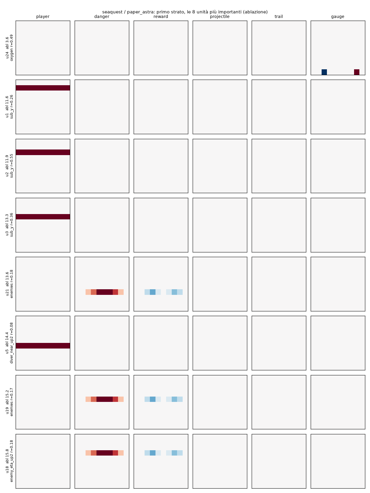
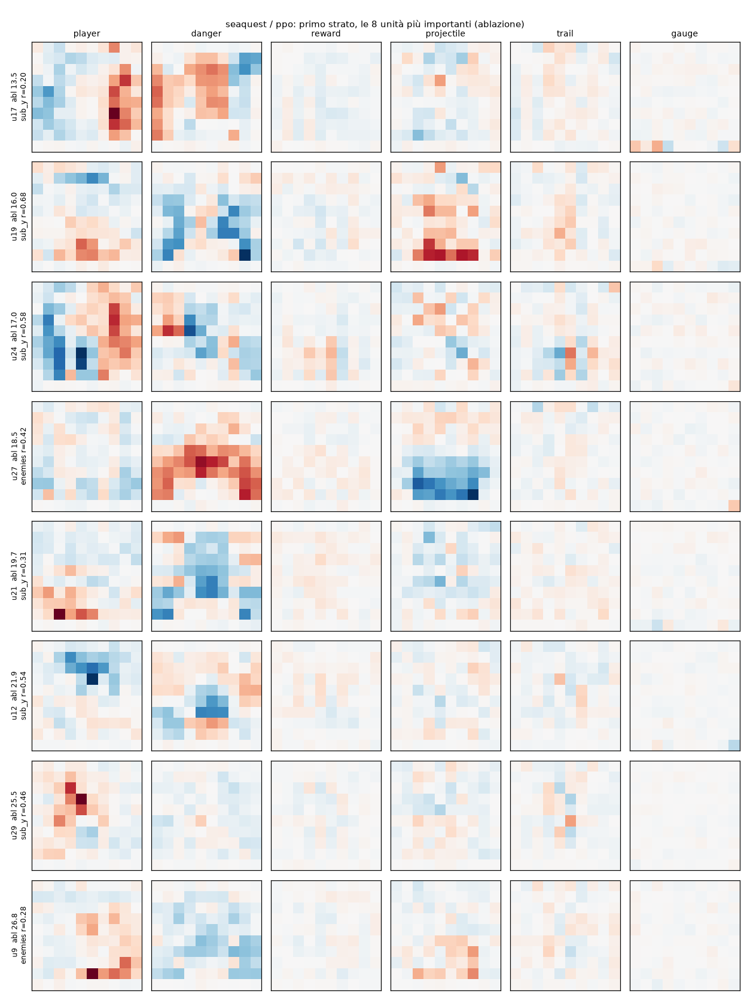

# PPO su Seaquest: che pesi trova, e si leggono?

`train.py` addestra con PPO una rete 600-32-32-6 tanh, la stessa architettura della rete che GPT-6 Astra ha scritto
a mano nell'articolo (`paper_astra.json`), e la salva in `weights/seaquest/ppo.json`. `analyze.py` fa le stesse
misure sulle due reti. La rete di Astra è decodificata neurone per neurone in
[`decode_astra`](../decode_astra/README.md) e fa da termine di paragone. Le misure sono quelle di
[PPO su Low Tide](../../low_tide/ppo/README.md) e di [PPO su Breakout](../../breakout/ppo/README.md), spiegate lì.

Seaquest è il gioco MinAtar in cui il confronto è alla pari: PPO gioca **meglio** di Astra.

**In breve.**

- **Come gioca:** 55.9 punti contro i 51.4 di Astra, e 107 contro 54 giocando sempre la mossa più probabile. Ma
  gioca in un altro modo: Astra resta fermo nella colonna 5 e sceglie solo la riga; PPO si muove tra le colonne 3 e
  6, girandosi a destra e a sinistra.
- **Come sono i pesi:** densi e distribuiti.
  - Usa tutti i 425 ingressi vivi, con 13.526 valori diversi; Astra il 2.6%, con 12 valori.
  - Tenendo metà dei pesi vivi del primo strato perde metà del punteggio, con un quarto non gioca più. Astra regge
    con il 5%.
  - Nessun neurone calcola "ossigeno basso" o "ora di emergere", che in Astra sono un neurone ciascuno (|r| 0.98 e
    1.00 contro 0.29). Eppure PPO emerge anche lui, e sale più spesso quando l'ossigeno è basso.
  - Un albero di profondità 6 lo imita nel 65% degli stati (Astra: 87%).
- **Cosa si legge:** i neuroni più importanti del primo strato hanno macchie localizzate nel canale del sottomarino
  (dove sono) combinate con macchie nei canali dei nemici (cosa c'è vicino). Non si lasciano ridurre a una grandezza
  del gioco.

```bash
uv run --group ppo python experiments/seaquest/ppo/train.py          # ~1h50 su un core (200M passi)
uv run --group analysis python experiments/seaquest/ppo/analyze.py   # ~10 min con 4 processi
```

## 1. L'addestramento

Come per Breakout (`src/small_games/ppo.py`, PPO con clipping e GAE): attore 600-32-32-6 tanh, critico 600-64-64-1,
64 ambienti, rollout da 128 passi, Adam lr 5·10⁻⁴ che scende a 0, sticky actions 0.1 come nella valutazione, seed
di addestramento lontani da quelli della valutazione. Tutte e sei le azioni (il minimal action set di MinAtar per
Seaquest è completo), **coefficiente di entropia 0.05**, 200 milioni di passi.

Il primo tentativo (`ppo_v1`, entropia 0.01, 30M passi) si era fermato a 5.4 punti. Le tre corse di
`experiments/ppo_runs.py` differiscono solo per il coefficiente di entropia:

| corsa | supera 10 punti | ritorno in addestramento a 50M / 100M / 200M | valutazione (1000 episodi) |
|---|---|---|---|
| `ppo_ent01` (0.01) | mai | 4.4 / 4.4 / 4.5 | 4.4 ± 0.05 |
| **`ppo_ent05` (0.05)** | **a 36M passi** | 24 / 37 / 57 | **55.9 ± 1.3** |
| `ppo_ent10` (0.1) | a 28M passi | 16 / 23 / 34 | 34.4 ± 1.0 |
| rete di Astra | | | 51.4 ± 1.4 |

Con l'entropia 0.01 PPO resta bloccato per tutti i 200M passi. `weights/seaquest/ppo.json` è `ppo_ent05`: la sua
curva sale ancora alla fine, quindi con più passi migliorerebbe probabilmente ancora.

## 2. Come gioca

| | `paper_astra` | `ppo_v1` | `ppo` |
|---|---|---|---|
| punteggio (200 episodi, campionata) | 48.3 ± 2.9 | 5.4 ± 0.1 | 56.0 ± 3.0 |
| punteggio greedy | 53.9 | 5.4 | 107.4 |

Sugli stati giocati dalle due reti (20 episodi, mosse più probabili):

| | `paper_astra` | `ppo` |
|---|---|---|
| colonna del sottomarino | sempre la 5 | 3: 14%, 4: 29%, 5: 35%, 6: 18% |
| rivolto a sinistra / a destra | 99% / 0% | 49% / 50% |
| mosse: fermo, sinistra, su, destra, giù, fuoco | 0, 0, 9, 0, 9, 81% | 5, 9, 31, 12, 29, 14% |
| sale, con ossigeno < 60 e almeno un sub a bordo / con ossigeno ≥ 60 | 72% / 6% | 57% / 27% |

Astra ha ridotto il gioco a una dimensione: fermo nella colonna 5, spara quasi sempre e sceglie la riga. PPO non ha
trovato questa semplificazione: si muove in orizzontale, si gira, spara molto meno. Anche PPO però impara a
emergere: con poco ossigeno e qualche sub a bordo sale il doppio delle volte.

## 3. Com'è fatto un peso PPO

| | `paper_astra` | `ppo_v1` | `ppo` |
|---|---|---|---|
| pesi diversi da zero | 3.6% | 100.0% | 100.0% |
| valori diversi nel primo strato | 12 | 18.735 | 18.950 |
| ingressi che fanno il 90% del peso di un neurone (mediana, su 600) | 9 | 354 | 302 |
| peso più grande in valore assoluto | 40.00 | 1.41 | 3.84 |

175 ingressi su 600 sono sempre zero: il canale gauge fuori dalla riga 9, la riga 9 degli altri canali e qualche
cella mai visitata. I pesi PPO su questi restano quelli dell'inizializzazione casuale (vedi Breakout). Ristretti agli
ingressi vivi:

| primo strato, solo i 425 ingressi vivi su 600 | `paper_astra` | `ppo_v1` | `ppo` |
|---|---|---|---|
| pesi diversi da zero | 2.6% | 100.0% | 100.0% |
| valori diversi | 12 | 13.422 | 13.526 |
| ingressi che fanno il 90% del peso di un neurone (mediana, su 425) | 9 | 254 | 240 |
| \|w\| medio sugli ingressi morti / vivi | 0.012 / 0.158 | 0.052 / 0.125 | 0.064 / 0.295 |

I pesi del primo strato dei neuroni più importanti (sezione 5), un pannello per canale, rosso positivo e blu
negativo.

**Rete di Astra:** neuroni "il sottomarino è nella riga r" (una riga intera del canale player), "c'è un pericolo
nella riga r vicino alla colonna 5" (canale danger, pesi centrati sulla colonna 5) e una soglia sull'ossigeno
(canale gauge).



**Rete PPO:**



Nel canale del sottomarino (player) ogni neurone ha macchie localizzate: positivo in una zona, negativo in un'altra
(u29 e u12 per esempio). È una codifica della posizione per zone, non per riga. Nei canali danger e projectile ci
sono macchie più larghe, spesso nella metà bassa dello schermo, a volte di segno opposto a quelle del sottomarino.
Le singole macchie hanno una forma; il neurone, che le somma tutte, non ha un nome.

Il primo strato di Astra pesa per il 47% il canale danger, per il 31% reward e per il 22% player, e ignora la scia:
non gli serve sapere dove vanno gli oggetti, perché aspetta che passino davanti alla colonna 5. PPO divide il peso
tra player (25%), danger (30%), projectile (24%) e trail (12%).

## 4. Quanti pesi servono (pruning)

Tutti gli strati (200 episodi):

| pesi tenuti | 100% | 50% | 25% | 10% | 5% | 2% |
|---|---|---|---|---|---|---|
| `paper_astra` | 48.3 | 48.3 | 49.8 | 1.0 | 1.0 | 0.7 |
| `ppo_v1` | 5.4 | 5.2 | 5.1 | 1.2 | 0.2 | 0.0 |
| `ppo` | 56.0 | 16.4 | 1.2 | 0.4 | 0.1 | 0.1 |

Solo il primo strato, sugli ingressi vivi:

| pesi vivi del primo strato tenuti | 100% | 50% | 25% | 10% | 5% |
|---|---|---|---|---|---|
| `paper_astra` | 48.3 | 48.3 | 48.3 | 48.3 | 48.3 |
| `ppo_v1` | 5.4 | 5.3 | 5.3 | 2.4 | 1.0 |
| `ppo` | 55.3 | 31.0 | 1.7 | 1.2 | 0.2 |

(Con tutti i pesi vivi `ppo` fa 55.3 invece di 56.0: qualche ingresso si accende in episodi di valutazione ma mai
negli stati usati per trovare quelli vivi.)

## 5. Quanto conta ogni neurone (ablazione)

| | neuroni (costanti) | che fanno perdere più del 10% | più del 50% | perdita massima | riferimento |
|---|---|---|---|---|---|
| `paper_astra` | 64 (6) | 40 | 29 | 42.1 | 45.7 ± 3.9 |
| `ppo_v1` | 64 (0) | 0 | 0 | 0.2 | 5.4 ± 0.2 |
| `ppo` | 64 (0) | 62 | 14 | 52.8 | 59.6 ± 4.6 |

In entrambe le reti quasi ogni neurone conta: in una rete da 32 unità per strato, toglierne una rompe il calcolo.
La differenza è nel significato. In Astra i neuroni indispensabili sono "il sottomarino è nella riga r", "pericolo
nella riga r", "ossigeno basso". In PPO il più importante (u23 del secondo strato, perdita 53 punti su 60) ha |r|
0.42 con la riga del sottomarino, e nessuna grandezza del gioco lo spiega meglio.

## 6. Cosa calcolano i neuroni

### Le quantità dell'algoritmo di Astra

| quantità | `paper_astra` r / R² | `ppo_v1` r / R² | `ppo` r / R² |
|---|---|---|---|
| ossigeno basso (< 60) | **0.98 / 0.93** | 0.20 / 0.48 | 0.29 / 0.19 |
| almeno un sub a bordo | 0.10 / 0.00 | 0.23 / 0.21 | 0.21 / 0.18 |
| ora di emergere (ossigeno < 60 e almeno un sub) | **1.00 / 1.00** | 0.17 / 0.39 | 0.29 / 0.19 |
| nemico vicino nella mia riga (≤ 2) | 0.07 / 0.03 | 0.14 / 0.00 | 0.28 / 0.22 |
| sub da salvare nella mia riga | 0.15 / 0.45 | 0.14 / 0.03 | 0.04 / 0.00 |

"Ora di emergere" in Astra è un neurone. In PPO non c'è, nemmeno come combinazione lineare dei neuroni di uno strato
(R² 0.19), anche se la rete si comporta come se la usasse (sezione 2). Le quantità di riga di Astra ("nemico vicino
nella mia riga") hanno r basso anche in Astra: Astra le calcola riga per riga, per le tre righe candidate, non per
"la mia riga" (sezioni 4 e 5 di `decode_astra`).

### Neuroni booleani o graduati

| | `paper_astra` strato 0 | `paper_astra` strato 1 | `ppo` strato 0 | `ppo` strato 1 |
|---|---|---|---|---|
| neuroni tanh saturi (\|a\| > 0.95) | 99% | 73% | 19% | 73% |
| neuroni con \|r\| ≥ 0.8 con una grandezza del gioco | 0/32 | 0/26 | 0/32 | 0/32 |
| R² medio di un neurone sulle grandezze del gioco | 0.12 | 0.15 | 0.26 | 0.28 |

Il primo strato di Astra è fatto di 32 condizioni vero/falso; quello di PPO di 32 neuroni graduati (nessuno saturo
nel 90% degli stati). Il vocabolario del gioco qui non distingue le due reti: spiega i neuroni PPO un po' meglio di
quelli di Astra (R² 0.26-0.28 contro 0.12-0.15), perché Astra calcola condizioni su singole righe e celle, che il
vocabolario (distanze, righe relative al sottomarino) non contiene. Il segno di un algoritmo, in Astra, è un altro:
ogni neurone è una condizione su pochi ingressi, con pesi tondi.

## 7. Si può scrivere come regola? (distillazione)

| profondità | `paper_astra` accordo / foglie / punti | `ppo_v1` | `ppo` |
|---|---|---|---|
| 1 | 84.2% / 2 | 36.2% / 2 | 38.7% / 2 |
| 2 | 85.1% / 4 / 0.0 | 44.2% / 4 / 1.1 | 52.8% / 4 / 1.3 |
| 4 | 87.2% / 16 / 0.7 | 46.1% / 16 / 0.8 | 59.6% / 16 / 1.3 |
| 6 | 87.1% / 45 | 50.7% / 37 | 65.2% / 57 |
| 8 | 90.9% / 106 / 3.3 | 52.9% / 67 / 1.8 | 70.4% / 154 / 5.9 |
| 12 | 93.0% / 326 / 9.1 | 53.4% / 120 / 1.6 | 71.8% / 424 / 13.3 |
| la rete, greedy | 53.9 | 5.4 | 107.4 |

L'84% di Astra a profondità 1 viene soprattutto dal fatto che spara nell'81% degli stati. Nessun albero gioca
bene: Seaquest punisce ogni errore (una mossa sbagliata vicino a un nemico costa una vita) e le grandezze del
vocabolario non bastano a scrivere la regola esatta, nemmeno quella di Astra. Ma l'albero di Astra sbaglia il 7%
delle mosse con 326 foglie, quello di PPO il 28% con 424.

L'albero di profondità 2 di PPO (53% di accordo) dice: "se c'è un bersaglio davanti entro 5 colonne e non ho già un
siluro in volo nella riga, spara; altrimenti vai verso le righe centrali". Una regola sensata, che però descrive
solo metà delle mosse.

## 8. Conclusione

- **Astra:** i pesi sono il programma. Condizioni vero/falso su righe e celle, pesi tondi su pochi ingressi, una
  strategia a una dimensione (fermo nella colonna 5).
- **PPO:** gioca meglio di Astra, e la sua soluzione non ha questa forma:
  - usa tutti gli ingressi vivi, con valori continui, e non regge il pruning;
  - ogni neurone conta, nessuno corrisponde a una grandezza del gioco o a una condizione dell'algoritmo di Astra;
  - anche il comportamento è più complesso: si muove in orizzontale e non si riassume in un albero corto.

L'unica traccia leggibile sono le macchie di posizione nel canale del sottomarino.

Lungo l'addestramento e con le altre entropie il quadro è lo stesso: vedi
[`experiments/ppo_over_training`](../../ppo_over_training/README.md).

## File

- `train.py`: configurazione e lancio dell'addestramento (quella di `ppo.json`).
- `analyze.py`: tutte le misure; con `--only-key` solo le quantità chiave e le misure sugli ingressi vivi.
- `results/ppo_ent01/`, `results/ppo_ent05/`, `results/ppo_ent10/`: le tre corse da 200M passi (curva
  `train_log.csv`, `checkpoint_*M.json` ogni 5M passi, `eval.json`, `final.pt`, `console.log`).
- `results/ppo_v1/`: il primo tentativo (entropia 0.01, 30M passi).
- `results/analysis/`: `analysis.json` (tutti i numeri), `trees_*.txt` (alberi di profondità 1-4), `fields_*.png`
  (immagini del primo strato).
